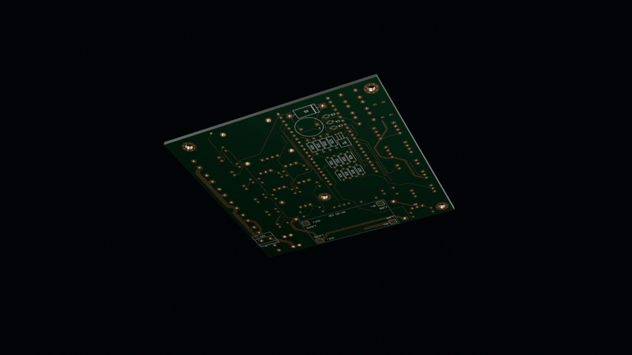
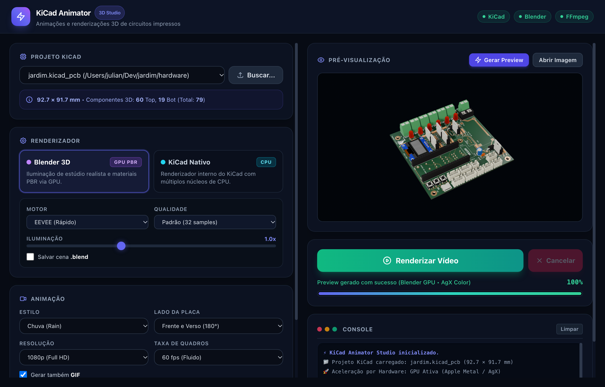

# KiCad Animator (3D Studio)

> **Crie vídeos e GIFs animados em 3D a partir das suas placas de circuito impresso do KiCad.**  
> *Create cinematic 3D animated videos and GIFs directly from your KiCad PCB projects.*

<p align="center">
  
</p>

<p align="center">
  <a href="#-português"><b>Português</b></a> • <a href="#-english"><b>English</b></a>
</p>

---

## 🌐 Português

### 💡 O que é o KiCad Animator?
O **KiCad Animator** é um aplicativo feito para transformar suas placas de circuito impresso do KiCad em videos animados. 

Você não precisa ser especialista em 3D: basta carregar o arquivo da sua placa (`.kicad_pcb`) e escolher uma das animações prontas:
- 🌧️ **Chuva Gravitacional (Rain):** os componentes 3D caem do céu e se encaixam na placa com impacto e rotação.
- 🌊 **Onda Radial (Wave):** os componentes surgem em uma onda expansiva a partir do centro da placa.
- ⚙️ **Montagem SMT:** simulação do processo de montagem sequencial de componentes na fábrica.
- 🌀 **Vórtice 3D:** componentes orbitam em espiral até pousarem nos seus devidos lugares.
- 🔄 **Giros 360° e 180°:** rotações suaves para mostrar a frente e o verso da sua placa.

---

### 📦 Como Instalar (Pronto para Usar)

1. Acesse a página de **[Releases](https://github.com/julianvitor/kicad_animator/releases)**.
2. Baixe o pacote do seu sistema operacional:
   - **Windows:** Baixe `KiCad-Animator-Windows-x64.zip`, extraia a pasta e clique duas vezes em `KiCad-Animator.exe`.
   - **macOS:** Baixe `KiCad-Animator-macOS.zip`, extraia e abra o `KiCad-Animator.app` (na primeira execução, pode ser necessário autorizar a abertura em *Ajustes do Sistema > Privacidade e Segurança*). 
3. Pronto! O programa já vem com tudo embutido.

---

### 🚀 Como Usar a Interface em 3 Passos

<p align="center">
  
</p>

1. **Escolha sua Placa:** Clique em *Buscar...* e selecione o arquivo `.kicad_pcb` do seu projeto.
2. **Escolha a Animação e o Visual:**
   - **Estilo:** Escolha o efeito desejado (*Chuva*, *Onda*, etc.).
   - **Motor:** 
     - **Blender 3D (GPU):** Máximo realismo com iluminação de estúdio profissional e materiais fiéis.
     - **KiCad Nativo (CPU):** Renderização direta e rápida usando o próprio motor do KiCad.
3. **Renderize:**
   - Clique em **Gerar Preview** para ver uma foto estática imediata de como vai ficar.
   - Clique em **Renderizar Vídeo** para gerar o arquivo `.mp4` e o `.gif` animado.

---

### ⚙️ Recursos Avançados (Para Desenvolvedores e Linha de Comando)

<details>
<summary><b>Clique para expandir instruções avançadas (Terminal, Scripts e Código-Fonte)</b></summary>

#### 1. Executar a partir do Código-Fonte (1 Clique)
Se você clonou o repositório e tem Python instalado:
- **Windows:** Dê duplo clique em `run_windows.bat` (ou execute `.\run_windows.ps1`).
- **Linux / macOS:** Execute `./run_unix.sh`.

*(Os scripts configuram automaticamente o ambiente virtual, Poetry e dependências).*

#### 2. Execução via Linha de Comando (CLI / Automação)
Ideal para automações, CI/CD ou renderizações em lote sem abrir a interface:
```bash
# Renderizar com Blender GPU (Chuva, 1080p, 60fps)
poetry run kicad-animator --pcb placa.kicad_pcb --backend blender --style rain --res 1080p --fps 60

# Renderizar com KiCad Nativo CPU (8 núcleos de processamento)
poetry run kicad-animator --pcb placa.kicad_pcb --backend kicad --workers 8 --res 1080p

# Gerar apenas 1 quadro estático para teste rápido
poetry run kicad-animator --pcb placa.kicad_pcb --still-frame 90 -o preview.png

# Modo interativo guiado no terminal
poetry run kicad-animator -i
```

#### 3. Gerar os Executáveis Standalone Localmente
- **Windows:** Execute `.\package_windows.ps1` no PowerShell.
- **macOS:** Execute `./package_mac.sh` no Terminal.

#### 4. Pré-requisitos Técnicos
| Ferramenta | Windows | Linux | macOS |
|------------|---------|-------|-------|
| **KiCad** (`kicad-cli`) | Instalação padrão / `PATH` | `/usr/bin/kicad-cli` | `/Applications/KiCad/...` |
| **FFmpeg** | `PATH` | `apt` / `pacman` | `brew install ffmpeg` |
| **Blender** *(opcional)* | Instalação padrão / `PATH` | `snap` / `flatpak` | `/Applications/Blender.app` |
| **Python** *(apenas código-fonte)* | `3.11` a `3.13` | `3.11` a `3.13` | `3.11` a `3.13` |

</details>

---

## 🌐 English

### 💡 What is KiCad Animator?
**KiCad Animator** turns your KiCad PCB designs into eye-catching, cinematic 3D animated videos and GIFs ready for social media, portfolios, product showcases, and client presentations.

No 3D modeling skills required: just load your `.kicad_pcb` file and pick a pre-built animation:
- 🌧️ **Gravity Rain:** 3D components fall onto the PCB and snap into place with realistic landing bounces.
- 🌊 **Radial Wave:** Components assemble outwards in a wave effect from the center of the board.
- ⚙️ **SMT Assembly:** Simulates automated pick-and-place manufacturing.
- 🌀 **3D Vortex:** Components spiral down smoothly onto their footprints.
- 🔄 **360° & 180° Showcases:** Smooth camera spins highlighting the front and back of your board.

---

### 📦 How to Install (Ready-to-Use)
You **do not need Python or terminal knowledge**. Simply download the standalone build:

1. Go to the **[Releases](https://github.com/julianvitor/kicad_animator/releases)** page.
2. Download the package for your OS:
   - **Windows:** Download `KiCad-Animator-Windows-x64.zip`, extract it, and double-click `KiCad-Animator.exe`.
   - **macOS:** Download `KiCad-Animator-macOS.zip`, extract it, and launch `KiCad-Animator.app` (on first launch, you may need to allow it in *System Settings > Privacy & Security*).
3. That's it! Everything is self-contained.

---

### 🚀 How to Use in 3 Simple Steps

<p align="center">
  
</p>

1. **Pick your Board:** Click *Buscar...* (*Browse*) and select your `.kicad_pcb` file.
2. **Choose Animation & Style:**
   - **Style:** Select the effect you want (*Rain*, *Wave*, *SMT Assembly*, etc.).
   - **Engine:**
     - **Blender 3D (GPU):** Photorealistic PBR materials, studio lighting, and AgX color grading.
     - **KiCad Native (CPU):** Fast multi-core raytracing using KiCad's internal CLI.
3. **Render:**
   - Click **Gerar Preview** (*Generate Preview*) for a quick 1-second still render.
   - Click **Renderizar Vídeo** (*Render Video*) to export your `.mp4` video and `.gif`.

---

### ⚙️ Advanced Features (Developers & Command-Line)

<details>
<summary><b>Click to expand advanced instructions (CLI, Source Code & Build)</b></summary>

#### 1. Running from Source (1-Click)
If you cloned the repository and have Python installed:
- **Windows:** Double-click `run_windows.bat` (or run `.\run_windows.ps1`).
- **Linux / macOS:** Run `./run_unix.sh`.

*(Scripts automatically configure virtualenv, Poetry, and dependencies).*

#### 2. Command-Line Usage (CLI / Automation)
Great for batch rendering, headless servers, and CI/CD pipelines:
```bash
# Blender GPU render (Rain effect, 1080p, 60fps)
poetry run kicad-animator --pcb board.kicad_pcb --backend blender --style rain --res 1080p --fps 60

# KiCad Native CPU render (8 parallel workers)
poetry run kicad-animator --pcb board.kicad_pcb --backend kicad --workers 8 --res 1080p

# Single still-frame test preview
poetry run kicad-animator --pcb board.kicad_pcb --still-frame 90 -o preview.png

# Interactive terminal wizard
poetry run kicad-animator -i
```

#### 3. Building Standalone Binaries Locally
- **Windows:** Run `.\package_windows.ps1` in PowerShell.
- **macOS:** Run `./package_mac.sh` in Terminal.

#### 4. Technical Requirements
| Tool | Windows | Linux | macOS |
|------|---------|-------|-------|
| **KiCad** (`kicad-cli`) | Default path / `PATH` | `/usr/bin/kicad-cli` | `/Applications/KiCad/...` |
| **FFmpeg** | `PATH` | `apt` / `pacman` | `brew install ffmpeg` |
| **Blender** *(optional)* | Default path / `PATH` | `snap` / `flatpak` | `/Applications/Blender.app` |
| **Python** *(source code only)* | `3.11` to `3.13` | `3.11` to `3.13` | `3.11` to `3.13` |

</details>
